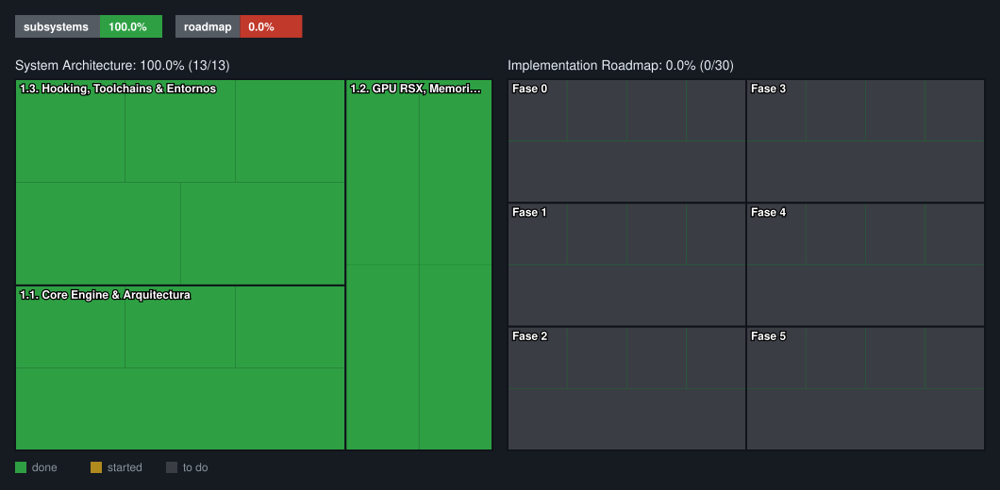

<div align="center">

# 🎮🔫 Voxel3D-PS3

### High-Performance 3D Voxel Item Rendering Engine for Minecraft: PlayStation 3 Edition

[](https://github.com/thelandy03-boop/Voxel3D-PS3)
[-2ea44f?style=flat-square&logo=minecraft&logoColor=white)](https://github.com/thelandy03-boop/Voxel3D-PS3)
[](docs/ARCHITECTURE.md)
[](docs/DEBUG_AND_TOOLCHAIN.md)
[](docs/ROADMAP.md)

<br/>

**[Documentación](docs/)** • **[Arquitectura](docs/ARCHITECTURE.md)** • **[Hoja de Ruta](docs/ROADMAP.md)** • **[Pipeline RSX](docs/RSX_PIPELINE.md)** • **[PPU Hooking](docs/PPU_HOOKING.md)** • **[Formato VX3](docs/VX3_FORMAT.md)**

<br/>

---

### 📊 Progreso General del Proyecto


</div>

<p align="center">
  
</p>

---

### 📌 Estado de los Hitos (Milestones)

| Fase | Componente / Hito | Barra de Progreso | % | Estado |
| :--- | :--- | :---: | :---: | :---: |
| **Fase 0** | Reversing de `EBOOT.BIN` & Mapeo de Offsets | `□□□□□□□□□□` | **0.0%** | ⚪ Pendiente |
| **Fase 1** | Pipeline Offline (`.vox` / `.bbmodel` ➔ `.vx3`) | `■■■■■■■■■■` | **100.0%** | 🟢 Completado |
| **Fase 2** | Scaffolding SPRX & Trampolines PPU (PPC ABI) | `■■■■■■□□□□` | **60.0%** | 🟡 En curso |
| **Fase 3** | Renderizado RSX de Bajo Nivel (`libgcm` Draw Calls) | `□□□□□□□□□□` | **0.0%** | ⚪ Pendiente |
| **Fase 4** | Cinemática ADS & Retroceso Amortiguado (LERP) | `□□□□□□□□□□` | **0.0%** | ⚪ Pendiente |
| **Fase 5** | Sistema Data-Driven (`config.json`) & Release v1.0 | `■■□□□□□□□□` | **20.0%** | 🟡 En curso |

---

## 📖 Visión General

**Voxel3D-PS3** es un proyecto de investigación y desarrollo de un plugin nativo en C++ (`.sprx`) para **Minecraft: PlayStation 3 Edition** (binario nativo C++ compilado originalmente por 4J Studios).

Su propósito es reemplazar el pipeline original de renderizado de ítems en primera persona (sprites planos 2D con extrusión dinámica de quads) por **mallas vóxel 3D precalculadas cargadas directamente en la VRAM local (RSX)**, emulando la estética y mecánicas de mods icónicos como *MrCrayfish's Gun Mod* sin colapsar el estrecho presupuesto de memoria y procesamiento de la consola.

> [!IMPORTANT]
> **PlayStation 3 opera con una arquitectura de memoria asimétrica (NUMA):** 256 MB XDR RAM (PPU) y 256 MB GDDR3 VRAM (RSX). Voxel3D-PS3 está diseñado bajo la premisa de **cero transferencias en caliente PPU-RSX**, manteniendo los modelos precalculados residentes en VRAM local (`CELL_GCM_LOCATION_LOCAL`).

---

## ⚙️ Arquitectura del Pipeline de Solución

```
[ Modelo Vóxel (Blockbench / MagicaVoxel) ]
                     │
                     ▼ (Conversor CLI Offline - Python/C++)
[ Archivo Plano Binario (.vx3) ]
  • Array contiguo de vértices optimizados (12 bytes: S16 coords, UB normals, flags, UVs)
  • Malla optimizada con culling de caras internas ocultas y greedy meshing
  • Tamaño ultra-compacto: ~15-35 KB por modelo
                     │
                     ▼ (Carga en memoria PS3)
[ Plugin Voxel3D-PS3 (.sprx) ]
  • Alocación de VBO estático en memoria local GDDR3 RSX (dev_gcm pool de 4 MB)
  • Hook atómico en ItemRenderer::renderItemInFirstPerson (PPU PowerPC)
  • Detección O(1) de ID de ítem/arma personalizada
  • Emisión de 1 solo Draw Call al RSX (cellGcmSetDrawIndexArray)
  • Interpolación matemática (LERP) de retroceso y apuntado ADS
```

---

## 📂 Estructura del Repositorio

```
Voxel3D-PS3/
├── README.md                  # Presentación general y estado
├── CONTRIBUTING.md            # Guía de contribución y política de cero métricas falsas
├── SECURITY.md                # Seguridad técnica, estabilidad y advertencias PSN
├── docs/                      # Centro de documentación técnica
│   ├── README.md              # Índice maestro categorizado
│   ├── ARCHITECTURE.md        # Arquitectura del hook y ciclo de render RSX GCM
│   ├── ASSET_PIPELINE.md      # Guía para modeladores 3D (Blockbench/MagicaVoxel)
│   ├── COMPILATION_GUIDE.md   # Compilación en Linux con ps3dev / PSL1GHT
│   ├── CONFIG_SPEC.md         # Formato JSON data-driven de configuración
│   ├── DEBUG_AND_TOOLCHAIN.md # Configuración de toolchain, RPCS3 y telemetría UDP
│   ├── ENGINE_STRUCTURES.md   # Reconstrucción de clases C++ del motor 4J Studios
│   ├── FAQ.md                 # Preguntas frecuentes técnicas y diseño
│   ├── MEMORY_MANAGEMENT.md   # Presupuestos de memoria VRAM/XDR y alocación
│   ├── PPU_HOOKING.md         # Mecanismos de intercepción PPU (PowerPC ABI y cache flush)
│   ├── REVERSE_ENGINEERING.md # Metodología de análisis de EBOOT.BIN (Ghidra/IDA)
│   ├── ROADMAP.md             # Hoja de ruta, hitos y matriz de mitigación de riesgos
│   ├── RSX_PIPELINE.md        # Pipeline de bajo nivel y shaders en GPU RSX (libgcm)
│   ├── VX3_FORMAT.md          # Especificación del formato binario .vx3
│   └── WINDOWS_SETUP.md       # Configuración para Windows (WSL2, MSYS2 y RPCS3)
├── sprx/                      # Código fuente del plugin nativo C++ (.sprx)
│   ├── Makefile               # Script de compilación PSL1GHT / ps3dev
│   ├── include/               # Cabeceras (.h)
│   └── src/                   # Implementación del hook y llamadas libgcm
├── tools/                     # Utilidades offline (conversor de mallas vóxel)
│   ├── converter/             # Script CLI para empaquetar modelos a .vx3
│   └── generate_status_svg.py # Generador dinámico del treemap de estado
└── models/                    # Modelos de prueba y especificaciones
```

---

## 🛠️ Requisitos y Herramientas

* **Toolchain de Compilación:** `PSL1GHT v2` / `ps3dev` (`ppu-lv2-gcc`)
* **Desensamblador / Decompilador:** Ghidra (con procesador PowerPC 64/32) o IDA Pro
* **Entorno de Prueba:** 
  * PlayStation 3 con Custom Firmware (CFW Evilnat 4.90/4.91 CEX/DEX o PS3HEN)
  * Emulador **RPCS3** con GDB server habilitado y RenderDoc (backend Vulkan)
* **Python 3.10+** (para herramientas del pipeline offline de modelos)

---

## 📜 Licencia

Proyecto de investigación educativa y desarrollo de software experimental de bajo nivel.
